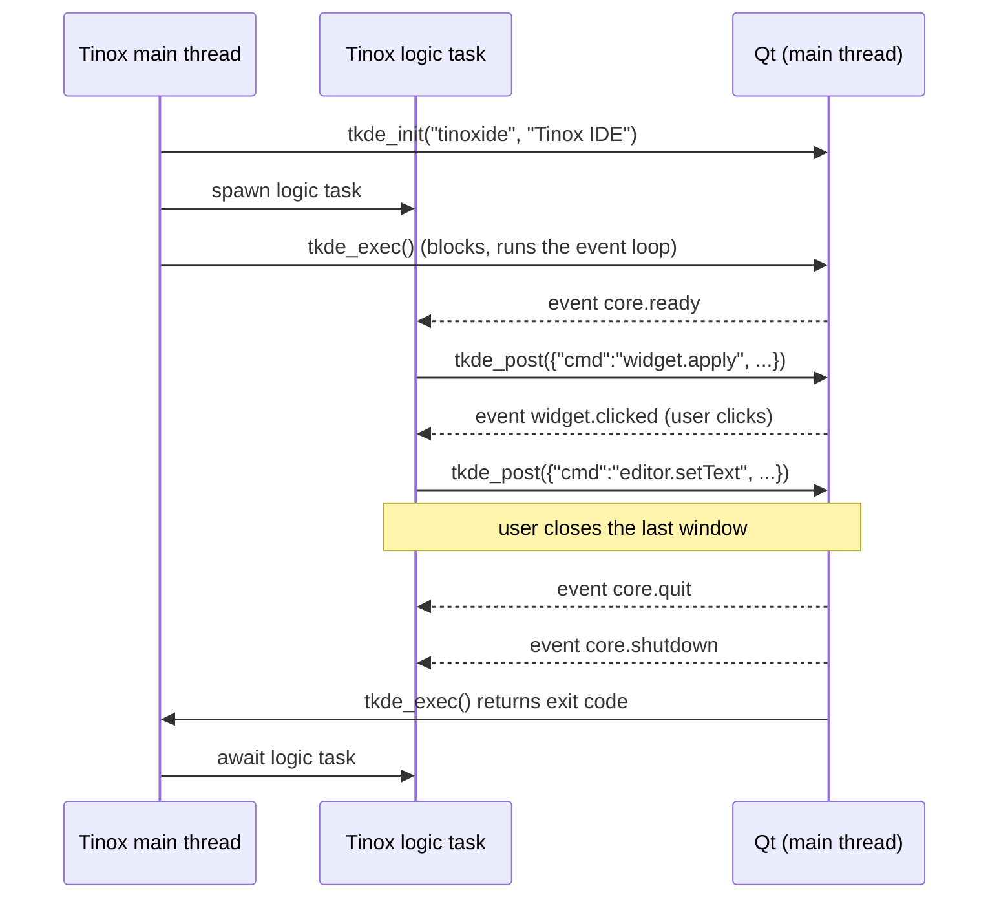
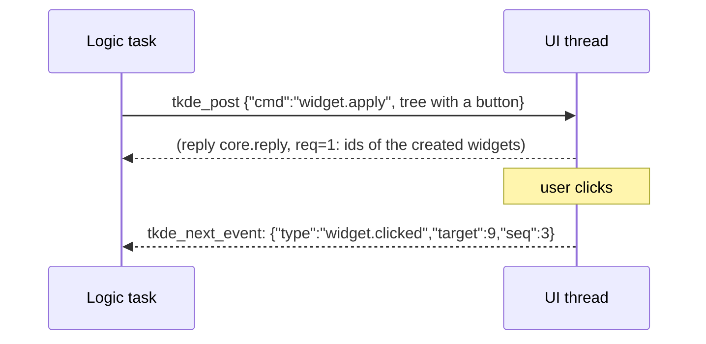
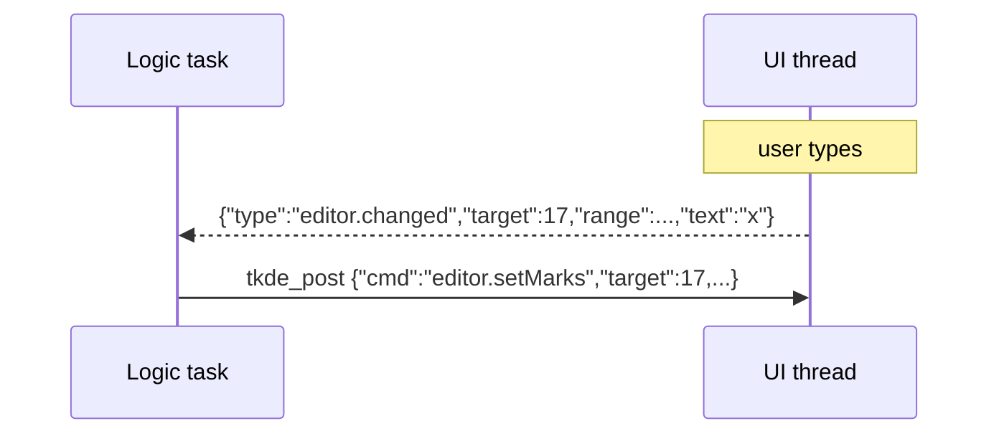

# libtinoxkde: the C ABI (version 1)

The contract between the IDE (written in Tinox) and the C++ bridge that owns Qt
and KDE Frameworks. The header is `bridge/include/tinoxkde.h`; this document is
the specification behind it. The mock bridge (issue #16), the Tinox bindings
(#17) and the real bridge (#8) are all written against it.

Why this shape: Tinox calls C functions through `extern fn` but cannot be
called back from C ([ADR 0001](adr/0001-architecture.md)). So the ABI is a few
functions that move **JSON messages** over two queues: commands from Tinox to
the UI thread, events from the UI thread to Tinox.

## 1. Rules for every function

| Rule | Meaning |
|---|---|
| Types | Only `int64_t` and `const char *` (UTF-8, NUL-terminated) cross the ABI. |
| Strings in | Borrowed for the duration of the call; the bridge copies what it keeps. `NULL` is invalid unless stated. |
| Strings out | A copy allocated with `GC_malloc_atomic` (or a static string). The caller owns it, never frees it, and may keep it forever. Never `NULL`: failures return `""`. |
| Pointers | No Tinox heap pointer is ever stored by the bridge; no bridge pointer is ever given to Tinox. Objects are named by ids (section 3). |
| Errors | Status functions return `0` or a negative `TKDE_E_*` code; `tkde_last_error()` explains the last failure of the calling thread. |
| Threads | Per function, see section 2. Calling from the wrong thread returns `TKDE_E_WRONG_THREAD`; it never crashes. |
| GC | Returned strings are Boehm GC allocations, so a thread that calls string-returning functions must be known to the collector. Tinox tasks are; any other thread (a C++ test client) must attach first (`GC_register_my_thread`, see `bridge/tests/gc_thread.h`). |
| Exceptions | None cross the boundary. |

## 2. Functions

| Function | Thread | Blocks | Purpose |
|---|---|---|---|
| `int64_t tkde_abi_version(void)` | any | no | The ABI version implemented (`TKDE_ABI_VERSION`, now 1). |
| `int64_t tkde_init(const char *app_name, const char *display_name)` | main | no | Creates the application object. `app_name` is the identifier (`tinoxide`: it names the config file `~/.config/tinoxiderc`, the notification component and the D-Bus service), `display_name` the human name. Returns `0`, `TKDE_E_ALREADY_INITIALIZED` or `TKDE_E_FAILED`. |
| `int64_t tkde_exec(void)` | main | until quit | Shows the windows created so far and runs the event loop. Returns the exit code (`>= 0`) or a negative error. |
| `void tkde_quit(void)` | any | no | Asks the loop to end; same as the `core.quit` command. |
| `int64_t tkde_post(const char *json)` | any | no | Queues a command. `0` when queued; errors that happen later arrive as events. |
| `const char *tkde_query(const char *json)` | non-UI | until answered | Runs a command on the UI thread and returns its reply JSON. Calling it from the UI thread is `TKDE_E_WRONG_THREAD`. |
| `const char *tkde_next_event(int64_t timeout_ms)` | any | up to timeout | The next event JSON, or `""` after the timeout (`< 0` waits forever). |
| `int64_t tkde_release(int64_t id)` | any | no | Drops the bridge's reference to an object; same as `core.release`. |
| `const char *tkde_last_error(void)` | any | no | Message of this thread's last failed call, `""` if none. |
| `int64_t tkde_now_ns(void)` | any | no | `CLOCK_MONOTONIC` in nanoseconds, the clock `t_ns` is stamped with. |
| `const char *tkde_getenv(const char *name)` | any | no | Value of an environment variable, `""` when unset. |

`tkde_init` and `tkde_exec` are called from the process main thread because Qt
requires it. A typical Tinox `main` calls `tkde_init`, `spawn`s the logic task,
then calls `tkde_exec`; the task uses only the "any" and "non-UI" functions.

### Error codes

| Code | Name | When |
|---|---|---|
| `0` | `TKDE_OK` | success |
| `-1` | `TKDE_E_INVALID_ARG` | `NULL` or malformed JSON, negative id |
| `-2` | `TKDE_E_WRONG_THREAD` | a main-thread function elsewhere, `tkde_query` on the UI thread |
| `-3` | `TKDE_E_NOT_INITIALIZED` | used before `tkde_init` |
| `-4` | `TKDE_E_ALREADY_INITIALIZED` | `tkde_init` twice |
| `-5` | `TKDE_E_NOT_FOUND` | unknown object id |
| `-6` | `TKDE_E_UNSUPPORTED` | unknown command or option (see versioning) |
| `-7` | `TKDE_E_FAILED` | anything else; the message says what |

## 3. Objects and ids

Widgets, documents, actions, models and so on live in the bridge and are named
by an `int64_t` id, **assigned by the bridge**, positive, never reused within a
run. `0` is invalid. A command that creates an object returns its id in the
reply (`"id": 17`). An id is released by `core.release` / `tkde_release` or when
its parent is destroyed; using a released id is `TKDE_E_NOT_FOUND`, not a crash.
The bridge keeps a registry of `QPointer`s, so an object destroyed from the Qt
side also becomes `NOT_FOUND` rather than dangling.

## 4. Messages

All messages are one JSON object in UTF-8, no embedded NUL.

### Commands (Tinox to UI)

```json
{"cmd": "editor.setText", "target": 17, "text": "hello", "req": 42}
```

* `cmd`: `"<namespace>.<verb>"`, required.
* `target`: id of the object addressed, when the command has one.
* `req`: optional integer chosen by the caller; the reply event carries it.
* All other fields belong to the command.

Commands from one thread are applied **in the order posted**. The bridge
applies them on the UI thread. An unknown `cmd` is `TKDE_E_UNSUPPORTED`; an
unknown *field* is ignored (this is what lets the ABI grow, section 7).

### Replies

The reply to a command is `{"ok": true, ...}` or
`{"ok": false, "error": {"code": -5, "message": "..."}}`.

* `tkde_query` returns the reply directly.
* A command sent with `tkde_post` and a `req` produces a `core.reply` event
  carrying `req` and the same fields. Without `req` a successful command
  produces nothing; a failed one produces a `core.error` event.

### Events (UI to Tinox)

```json
{"type": "widget.clicked", "seq": 1204, "t_ns": 357649152755932, "target": 9}
```

* `type`: `"<namespace>.<name>"`.
* `seq`: strictly increasing per process, starting at 1. A gap means loss.
* `t_ns`: `tkde_now_ns()` at the time of the event.
* `target`: object the event comes from, if any.

Events from one object are delivered in the order they happened. The queue is
bounded (65536 events). If it overflows the **oldest** events are dropped and
replaced by a single `core.overflow` event at the front of the queue that stands
for the lost range: its `seq` is the first dropped `seq`, `last_seq` the last,
`dropped` the number of events. The next delivered event therefore has
`seq = last_seq + 1`; nothing is lost silently.

### Core namespace (implemented by the bridge core, #8, and the mock, #16)

| Message | Fields | Effect |
|---|---|---|
| command `core.ping` | `payload` (any) | reply `{"ok":true,"payload":<same>}`; round-trip test |
| command `core.capabilities` | | reply `{"ok":true,"abi":1,"namespaces":["core","widget",...],"qt":"6.12.0","kf":"6.31.0"}` |
| command `core.release` | `target` | releases the object |
| command `core.quit` | `code` (default 0) | ends `tkde_exec` with that exit code |
| command `core.log` | `level`, `message` | writes to the bridge's log category |
| command `core.message` | `topic` (string, required), `payload` (any) | puts a `core.message` event into the event stream; safe from any thread, so background tasks can report to the logic task |
| event `core.ready` | | the event loop started and the windows are shown |
| event `core.reply` | `req`, `ok`, ... | reply to a posted command |
| event `core.message` | `topic`, `payload` | what a `core.message` command sent |
| event `core.error` | `error`, `cmd` | a posted command without `req` failed |
| event `core.overflow` | `dropped`, `last_seq` | events `seq`..`last_seq` were dropped (see above) |
| event `core.quit` | `code` | quit was requested (before windows close) |
| event `core.shutdown` | | last event; after it `tkde_next_event` returns `""` |

### Feature namespaces

Defined by the issues that build them; each adds a section here when it lands.
Until then the namespace is not in `core.capabilities`.

| Namespace | Issue | Content |
|---|---|---|
| `i18n` | #32 | **implemented**, see [i18n.md](i18n.md): `i18n.translate` for messages Tinox assembles at run time |
| `editor` | #12 | **implemented**, see [editor.md](editor.md): KTextEditor documents and views, edits, diagnostics, completion, hover |
| `widget` | #9 | **implemented**, see [widget.md](widget.md): declarative widget tree, layouts, docks, tabs, widget events |
| `action` | #10 | **implemented**, see [action.md](action.md): actions, menus, toolbars, shortcuts, command palette backend |
| `model` | #11 | **implemented**, see [model.md](model.md): item models for trees, lists and tables with lazy children, proxies, selection, drag and drop |
| `dialog`, `config`, `notify` | #13 | **implemented**, see [dialog.md](dialog.md): file/message/input/progress/settings dialogs, KConfig by group and key, notifications |
| `term` | #14 | embedded terminal |

## 5. Lifecycle and shutdown



* The logic task decides what to do on `core.quit`; the loop ends when the last
  window closes or `core.quit` is posted.
* After `core.shutdown` no more events are produced; `tkde_next_event` returns
  `""` immediately and `tkde_post` returns `TKDE_E_NOT_INITIALIZED`.

### A button click



### An editor change



## 6. Memory and threads, in short

* The UI thread is the only thread that touches Qt objects.
* `tkde_post`, `tkde_next_event`, `tkde_query` take a mutex only for the queue;
  they never run Qt code on the caller's thread.
* Every string handed to Tinox is a fresh GC allocation, so the collector owns
  its lifetime; the bridge keeps no reference to it.
* Tinox never keeps a bridge pointer: only ids.
* No function calls back into Tinox, so no thread needs `tinox_thread_attach`.

## 7. Versioning

* `TKDE_ABI_VERSION` is the integer in `tkde_abi_version()`. It is bumped only
  for an incompatible change, which should never happen after v1.
* **Additive evolution:** new functions, new commands, new events, new fields.
  Consumers ignore unknown events and unknown fields; the bridge ignores unknown
  command fields and rejects unknown commands with `TKDE_E_UNSUPPORTED`.
  Existing names, fields and meanings never change.
* A Tinox program checks `tkde_abi_version()` against the version it was built
  for and `core.capabilities` for the namespaces it needs, and fails with a clear
  message instead of misbehaving.
* The shared library's SONAME major version equals the ABI version.

### Semantic tokens

`editor.setSemanticTokens {target: documentId, version, legend: [tokenType, ...],
data: [deltaLine, deltaStart, length, tokenTypeIndex, modifierBits, ...],
colors?: {tokenType: "#RRGGBB"}}` atomically replaces the document's semantic
foreground overlay. Positions and lengths are UTF-16 units; tokens must be
single-line, ordered, nonoverlapping and within the current document. Version is
mandatory and must equal `editor.info.version`. Bad data/colours reject the whole
batch; empty data clears it. Reply: `{count}`. Moving ranges track edits until
replaced and are removed before document release or reload. Colours follow the
view's theme with optional per-type overrides; see [semantic highlighting](semantic-highlighting.md).
With debug commands enabled, `editor.debug.semanticTokens {target}` returns
`{items: [{type, range, color}]}` for integration tests.
